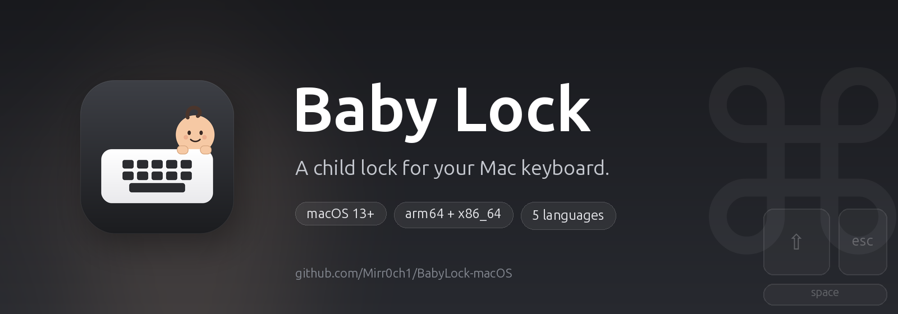

<p align="center">
  
</p>

<p align="center">
  <a href="https://github.com/Mirr0ch1/BabyLock-macOS/actions/workflows/build.yml"></a>
  <a href="https://github.com/Mirr0ch1/BabyLock-macOS/releases/latest"></a>
  <a href="https://github.com/Mirr0ch1/BabyLock-macOS/releases"></a>
  
</p>

<p align="center">
  
  
  
  
</p>

<p align="center">
  
  
  
</p>

<p align="center">
  <a href="README.md">简体中文</a> · <b>English</b> · <a href="README.zh-Hant.md">繁體中文</a> · <a href="README.fr.md">Français</a> · <a href="README.ru.md">Русский</a>
</p>

<h1 align="center">Baby Lock</h1>

<p align="center">
  <b>A child lock for your Mac keyboard.</b><br>
  Your child can drum on the keyboard. Nothing happens.
</p>

---

## Why I built this

I work from home. My daughter likes to climb onto my lap, point at the screen, and then — with great enthusiasm — slap the keyboard.

Most of the time nothing catastrophic happens. But every so often a palm lands on `⌘W`, a tiny finger finds the power key, or a full sentence of gibberish goes straight into a chat window. Shutting the Mac down is overkill. Locking the whole screen means I cannot show her anything. Moving the laptop away interrupts the moment.

Baby Lock is the middle ground: **the Mac keeps working, the screen stays visible, and the keyboard stops listening.**

I turn it on from the menu bar before she reaches the keyboard. When she is done, I hold the left and right `⌘` keys for three seconds and everything is back.

## How it works

1. Click the Baby Lock icon in the menu bar.
2. Choose **Turn on Baby Lock**.
3. A floating hint appears at the bottom of the screen. The keyboard no longer responds.
4. To unlock, hold the **left and right Command keys for 3 seconds**.

By default the desktop stays exactly as it is: no black screen, no app switching, no stolen focus. If you want a clean dark surface — while wiping the keyboard, for example — turn on **Black out displays** in Settings.

## Features

- Blocks every key, including shortcuts and media keys; keep one or more keys working while locked (for example 🌐 Fn for dictation, or `⌃` + `C` + `V` for copy and paste).
- Checks GitHub Releases at launch and from the menu bar, downloads a verified update, installs it in place, and restarts.
- Resets and re-requests permissions from the permissions screen after an update or a stale grant.
- Optionally blocks trackpad/mouse clicks, scrolling, and gestures, and hides the pointer.
- Unlocks with `Left ⌘` + `Right ⌘` held for 3 seconds, with a progress ring.
- Optional full-screen blackout, off by default; all displays or main display only.
- Automatic safety timeout: 5, 10, or 20 minutes.
- Native menu bar app (`LSUIElement`), no Dock icon.
- Follows the system language, with English fallback.
- Five languages: English, 简体中文, 繁體中文, Français, Русский.
- No analytics or key logging; the only network request is the GitHub update check.

## What is different from CleanLock

Baby Lock started as a fork of [CleanLock](https://github.com/fromtimo/CleanLock) and keeps its reliable input-blocking core. The changes are aimed at everyday family use:

| | CleanLock | Baby Lock |
|---|---|---|
| Purpose | Cleaning the MacBook | Keeping a child's input out |
| Default screen | Full-screen black overlay | Desktop stays visible, small floating hint |
| Blackout | Always on | Optional, off by default |
| Display scope | All / main display | Same, only when blackout is enabled |
| Pointer blocking | Always on | Optional, on by default |
| Languages | English, Russian | English, 简体中文, 繁體中文, Français, Русский |
| Icon | Keyboard + lock | Keyboard + baby |
| Builds | Local Xcode | GitHub Actions (universal) |

## Installation

1. Open the [latest release](https://github.com/Mirr0ch1/BabyLock-macOS/releases).
2. Download `BabyLock-macOS.zip` and unzip it.
3. Drag **Baby Lock.app** into `/Applications`.
4. The build is ad-hoc signed but **not notarized by Apple**, so macOS may warn on first launch. If it says the app is damaged, run:

   ```bash
   xattr -dr com.apple.quarantine "/Applications/Baby Lock.app"
   ```

5. Launch Baby Lock and complete the onboarding.

## Permissions

Baby Lock needs two macOS permissions:

- **Accessibility** — to block keyboard and pointer events while the lock is on.
- **Input Monitoring** — to recognize the left/right Command unlock gesture.

Both are used only locally. Keystrokes are never logged or transmitted. The optional exempt keys are stored in your preferences.

> The release is ad-hoc signed, so macOS may ask for permissions again after you replace the app with a new build.

If System Settings already shows the switches on but Baby Lock still says they are missing, macOS is holding a grant for the previous build. Open the permissions screen and click **Reset permissions and retry**: Baby Lock clears its Accessibility and Input Monitoring entries, relaunches, and asks again.

## Settings

- **Launch at login**
- **Language** — follow the system, or pin one of the five languages
- **Auto-unlock** — safety timer (5 / 10 / 20 minutes)
- **Block trackpad and mouse** — on by default
- **Exempt keys** — stay usable while locked; add several keys. For a shortcut, add every key separately (e.g. `⌃`, `C`, `V`); use **Bind Fn key** if another input method intercepts Fn
- **Black out displays** — off by default, with all-displays / main-display scope
- **Check for Updates** (menu bar) — checks GitHub Releases, then downloads and installs a newer build

## Updates

Baby Lock checks GitHub Releases at launch. Use **Check for Updates** in the menu bar to check manually:

- the menu stays open and shows **Checking for Updates…**;
- no update: **No Updates Available**, then it resets to **Check for Updates** after three seconds;
- update available: **Update vX.Y.Z — Click to Install**; after confirmation it downloads the release, verifies the bundle ID, version, and signature, replaces the app, resets permissions, and restarts.

The app must be in `/Applications` or `~/Applications` to install an update. Release builds are ad-hoc signed, so macOS may ask you to re-authorize Accessibility and Input Monitoring after an update. Baby Lock opens the permission screen and offers **Reset permissions and retry**.

## Build

### GitHub Actions

Every push to `main` and every `v*` tag builds a universal `arm64 + x86_64` app on a macOS runner, signs it ad hoc, and uploads `BabyLock-macOS.zip`. Tags also publish a GitHub release.

### Local development

Requirements: macOS 13+, Xcode 15+.

```bash
open BabyLock.xcodeproj
# or
./Scripts/run-debug.sh
```

`Scripts/build-debug.sh` assembles `build/Debug/Baby Lock.app` with `swiftc`. `Scripts/reset-dev-state.sh` clears preferences and TCC entries for a clean run.

Regenerate the icons and banners:

```bash
python3 -m pip install cairosvg pillow
python3 Scripts/generate-icons.py
python3 Scripts/generate-banner.py
```

## Localization

All user-facing strings live in standard `.lproj/Localizable.strings` bundles:

```text
BabyLock/Resources/en.lproj/Localizable.strings
BabyLock/Resources/zh-Hans.lproj/Localizable.strings
BabyLock/Resources/zh-Hant.lproj/Localizable.strings
BabyLock/Resources/fr.lproj/Localizable.strings
BabyLock/Resources/ru.lproj/Localizable.strings
```

Missing keys fall back to English. To add a language, add the `.lproj` folder, register it in `BabyLock.xcodeproj`, and add the language to `AppLanguage`.

## Credits

Baby Lock is based on **[CleanLock](https://github.com/fromtimo/CleanLock)** by [fromtimo](https://github.com/fromtimo). The input-blocking architecture, permission handling, and unlock gesture come from that project. Huge thanks to the original author.

The original MIT license and copyright notice are retained; see [LICENSE](LICENSE).

## License

MIT. See [LICENSE](LICENSE).
