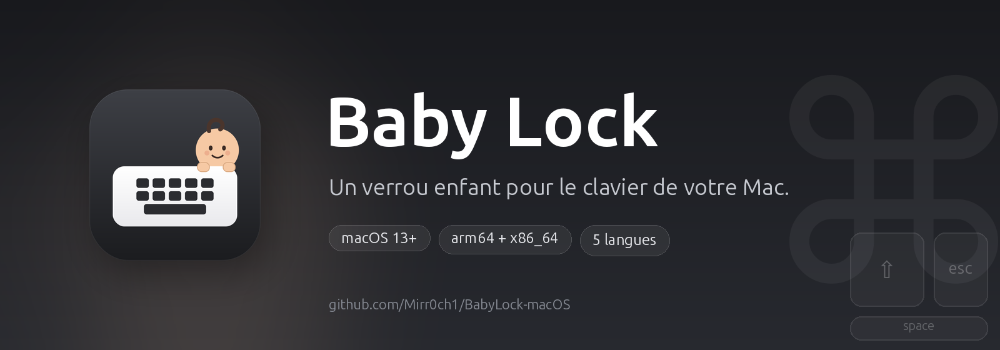

<p align="center">
  
</p>

<p align="center">
  <a href="https://github.com/Mirr0ch1/BabyLock-macOS/actions/workflows/build.yml"></a>
  <a href="https://github.com/Mirr0ch1/BabyLock-macOS/releases/latest"></a>
  <a href="https://github.com/Mirr0ch1/BabyLock-macOS/releases"></a>
  
</p>

<p align="center">
  
  
  
  
</p>

<p align="center">
  
  
  
</p>

<p align="center">
  <a href="README.md">简体中文</a> · <a href="README.en.md">English</a> · <a href="README.zh-Hant.md">繁體中文</a> · <b>Français</b> · <a href="README.ru.md">Русский</a>
</p>

<h1 align="center">Baby Lock</h1>

<p align="center">
  <b>Un verrou enfant pour le clavier de votre Mac.</b><br>
  Votre enfant peut taper sur le clavier : rien ne se passe.
</p>

---

## Pourquoi j'ai créé cette app

Je travaille à la maison. Ma fille aime grimper sur mes genoux, pointer l'écran, puis — avec beaucoup d'enthousiasme — taper sur le clavier.

La plupart du temps, il ne se passe rien de grave. Mais parfois une paume atterrit sur `⌘W`, un petit doigt trouve le bouton d'alimentation, ou une phrase entière de charabia part directement dans une fenêtre de chat. Éteindre le Mac est excessif. Verrouiller tout l'écran m'empêche de lui montrer quelque chose. Déplacer l'ordinateur interrompt le moment.

Baby Lock est le compromis : **le Mac continue de fonctionner, l'écran reste visible, et le clavier arrête d'écouter.**

Je l'active depuis la barre des menus avant qu'elle n'atteigne le clavier. Quand elle a fini, je maintiens les touches `⌘` gauche et droite pendant trois secondes et tout revient à la normale.

## Comment ça marche

1. Cliquez sur l'icône Baby Lock dans la barre des menus.
2. Choisissez **Activer Baby Lock**.
3. Une petite bulle flottante apparaît en bas de l'écran. Le clavier ne répond plus.
4. Pour déverrouiller, maintenez les **touches Commande gauche et droite pendant 3 secondes**.

Par défaut, le bureau reste exactement tel quel : pas d'écran noir, pas de changement d'application, pas de vol de focus. Si vous voulez une surface sombre — pour nettoyer le clavier, par exemple — activez **Écrans noirs** dans les réglages.

## Fonctionnalités

- Bloque toutes les touches, y compris les raccourcis, les touches multimédia et l'appui bref sur la touche d'alimentation ; gardez une ou plusieurs touches actives pendant le verrouillage (par exemple 🌐 Fn pour dicter, ou `⌃` + `C` + `V` pour copier-coller).
- Vérifie les versions GitHub au lancement et depuis la barre des menus, puis télécharge, vérifie, installe et redémarre les mises à jour.
- Réinitialise et redemande les autorisations depuis l'écran des autorisations après une mise à jour ou une autorisation obsolète.
- Peut bloquer les clics, le défilement et les gestes du trackpad/de la souris, et masquer le pointeur.
- Déverrouillage avec `⌘` gauche + `⌘` droite maintenus 3 secondes, avec un anneau de progression.
- Écran noir plein écran en option, désactivé par défaut ; tous les écrans ou l'écran principal uniquement.
- Minuteur de sécurité automatique : 5, 10 ou 20 minutes.
- Application native de barre des menus (`LSUIElement`), sans icône dans le Dock.
- Suit la langue du système, avec repli sur l'anglais.
- Cinq langues : English, 简体中文, 繁體中文, Français, Русский.
- Aucune analyse ni journalisation des touches ; la seule requête réseau est la vérification des mises à jour GitHub.

## Différences avec CleanLock

Baby Lock est un fork de [CleanLock](https://github.com/fromtimo/CleanLock) et conserve son noyau de blocage des entrées. Les changements visent l'usage familial quotidien :

| | CleanLock | Baby Lock |
|---|---|---|
| Objectif | Nettoyer le MacBook | Bloquer les entrées d'un enfant |
| Écran par défaut | Voile noir plein écran | Bureau visible, petite bulle flottante |
| Écran noir | Toujours actif | Optionnel, désactivé par défaut |
| Portée des écrans | Tous / écran principal | Identique, uniquement en mode écran noir |
| Blocage du pointeur | Toujours actif | Optionnel, actif par défaut |
| Langues | Anglais, russe | Anglais, 简体中文, 繁體中文, français, russe |
| Icône | Clavier + cadenas | Clavier + bébé |
| Compilation | Xcode local | GitHub Actions (binaire universel) |

## Installation

1. Ouvrez la [dernière version](https://github.com/Mirr0ch1/BabyLock-macOS/releases).
2. Téléchargez `BabyLock-macOS.zip` et décompressez-le.
3. Glissez **Baby Lock.app** dans `/Applications`.
4. La version est signée ad hoc mais **pas notariée par Apple**, macOS peut donc afficher un avertissement au premier lancement. Si l'app est déclarée endommagée, exécutez :

   ```bash
   xattr -dr com.apple.quarantine "/Applications/Baby Lock.app"
   ```

   Téléchargez uniquement depuis les [Releases](https://github.com/Mirr0ch1/BabyLock-macOS/releases) de ce projet et vérifiez les fichiers `.sha256` et `.sig` ; n'utilisez pas de miroir tiers.

5. Lancez Baby Lock et terminez la configuration guidée.

## Autorisations

Baby Lock a besoin de deux autorisations macOS :

- **Accessibilité** — pour bloquer les événements du clavier et du pointeur pendant le verrouillage.
- **Surveillance des entrées** — pour reconnaître le geste de déverrouillage avec les touches Commande.

Les deux sont utilisées uniquement en local. Les frappes ne sont jamais enregistrées ni transmises. Les touches exemptées facultatives sont stockées dans vos préférences.

> La version étant signée ad hoc, macOS peut redemander les autorisations après le remplacement de l'app par une nouvelle version.

Si Réglages Système montre déjà les interrupteurs activés mais que Baby Lock dit qu'ils manquent, macOS conserve l'autorisation de la version précédente. Ouvrez l'écran des autorisations et cliquez sur **Réinitialiser les autorisations et réessayer** : Baby Lock efface ses entrées Accessibilité et Surveillance des entrées, redémarre et redemande l'accès.

## Réglages

- **Ouvrir à la connexion**
- **Langue** — suivre le système ou fixer l'une des cinq langues
- **Déverrouillage automatique** — minuteur de sécurité (5 / 10 / 20 minutes)
- **Bloquer le trackpad et la souris** — actif par défaut
- **Touches exemptées** — restent actives pendant le verrouillage ; ajoutez-en plusieurs. Pour un raccourci, ajoutez chaque touche séparément (par ex. `⌃`, `C`, `V`) ; utilisez **Lier Fn** si une méthode de saisie l'intercepte
- **Écrans noirs** — désactivé par défaut, avec portée tous les écrans / écran principal
- **Rechercher les mises à jour** (barre des menus) — vérifie les versions GitHub et installe la nouvelle version

## Mises à jour

Baby Lock vérifie les versions GitHub au lancement. Cette vérification est silencieuse : sans mise à jour, le menu reste sur **Rechercher les mises à jour** ; seule une version plus récente modifie l'élément. Utilisez **Rechercher les mises à jour** dans la barre des menus pour vérifier manuellement :

- le menu reste ouvert et affiche **Recherche de mises à jour…** ;
- aucune mise à jour : **Aucune mise à jour disponible**, puis retour à **Rechercher les mises à jour** après trois secondes ;
- mise à jour disponible : **Mise à jour vX.Y.Z — Installer** ; après confirmation, elle télécharge la version publiée, vérifie la signature Ed25519, l'identifiant du bundle et la version, remplace l'app, réinitialise les autorisations et redémarre.

Les archives de mise à jour portent une signature Ed25519. L'app épingle la clé publique ; une signature absente ou invalide est refusée et la version actuelle est conservée.

L'app doit se trouver dans `/Applications` ou `~/Applications` pour installer une mise à jour. Les versions publiées sont signées ad hoc : macOS peut donc demander de réautoriser Accessibilité et Surveillance des entrées après une mise à jour. Baby Lock ouvre l'écran des autorisations et propose **Réinitialiser les autorisations et réessayer**.

## Limites

- Un appui bref sur la touche d'alimentation est bloqué pendant le verrouillage ; maintenir la touche 5 à 10 secondes force toujours l'arrêt, comme issue de secours matérielle.
- Fermer le capot ou mettre le Mac en veille reverrouille automatiquement au réveil.
- Un redémarrage, un arrêt forcé ou une fermeture forcée ne restaure pas le verrouillage ; l'état est uniquement en mémoire.
- Le geste de déverrouillage est affiché dans le HUD. Un enfant qui sait lire peut l'apprendre ; ce n'est donc pas un verrou de sécurité fort contre des enfants plus âgés.
- Un clavier sans touche Commande droite ne permet pas le geste de déverrouillage ; attendez le minuteur d'auto-déverrouillage ou utilisez l'appui long sur la touche d'alimentation.
- Quitter de force l'app pendant le verrouillage peut laisser le curseur masqué ou figé ; une mise en veille/réveil ou une reconnexion le rétablit généralement.
- Les autres processus de la même session, Voice Control, le partage d'écran et la gestion à distance MDM ne sont pas protégés.
- Les versions publiées sont signées ad hoc ; macOS peut redemander les autorisations après la première installation ou une mise à jour.

## Compilation

### GitHub Actions

Chaque push sur `main` et chaque tag `v*` compile une app universelle `arm64 + x86_64` sur un runner macOS, la signe ad hoc et téléverse `BabyLock-macOS.zip` ; les builds de tag produisent aussi une signature Ed25519 et un SHA256. Les tags publient une release GitHub.

### Développement local

Prérequis : macOS 13+, Xcode 15+.

```bash
open BabyLock.xcodeproj
# ou
./Scripts/run-debug.sh
```

`Scripts/build-debug.sh` assemble `build/Debug/Baby Lock.app` avec `swiftc`. `Scripts/reset-dev-state.sh` efface les préférences et les entrées TCC pour repartir proprement.

Régénérer les icônes et les bannières :

```bash
python3 -m pip install cairosvg pillow
python3 Scripts/generate-icons.py
python3 Scripts/generate-banner.py
```

## Localisation

Toutes les chaînes visibles sont dans des bundles `.lproj/Localizable.strings` standards :

```text
BabyLock/Resources/en.lproj/Localizable.strings
BabyLock/Resources/zh-Hans.lproj/Localizable.strings
BabyLock/Resources/zh-Hant.lproj/Localizable.strings
BabyLock/Resources/fr.lproj/Localizable.strings
BabyLock/Resources/ru.lproj/Localizable.strings
```

Les clés manquantes reviennent à l'anglais. Pour ajouter une langue, ajoutez le dossier `.lproj`, enregistrez-le dans `BabyLock.xcodeproj` et ajoutez la langue à `AppLanguage`.

## Crédits

Baby Lock est basé sur **[CleanLock](https://github.com/fromtimo/CleanLock)** de [fromtimo](https://github.com/fromtimo). L'architecture de blocage des entrées, la gestion des autorisations et le geste de déverrouillage viennent de ce projet. Un grand merci à l'auteur original.

La licence MIT et le copyright d'origine sont conservés ; voir [LICENSE](LICENSE).

## Licence

MIT. Voir [LICENSE](LICENSE).
