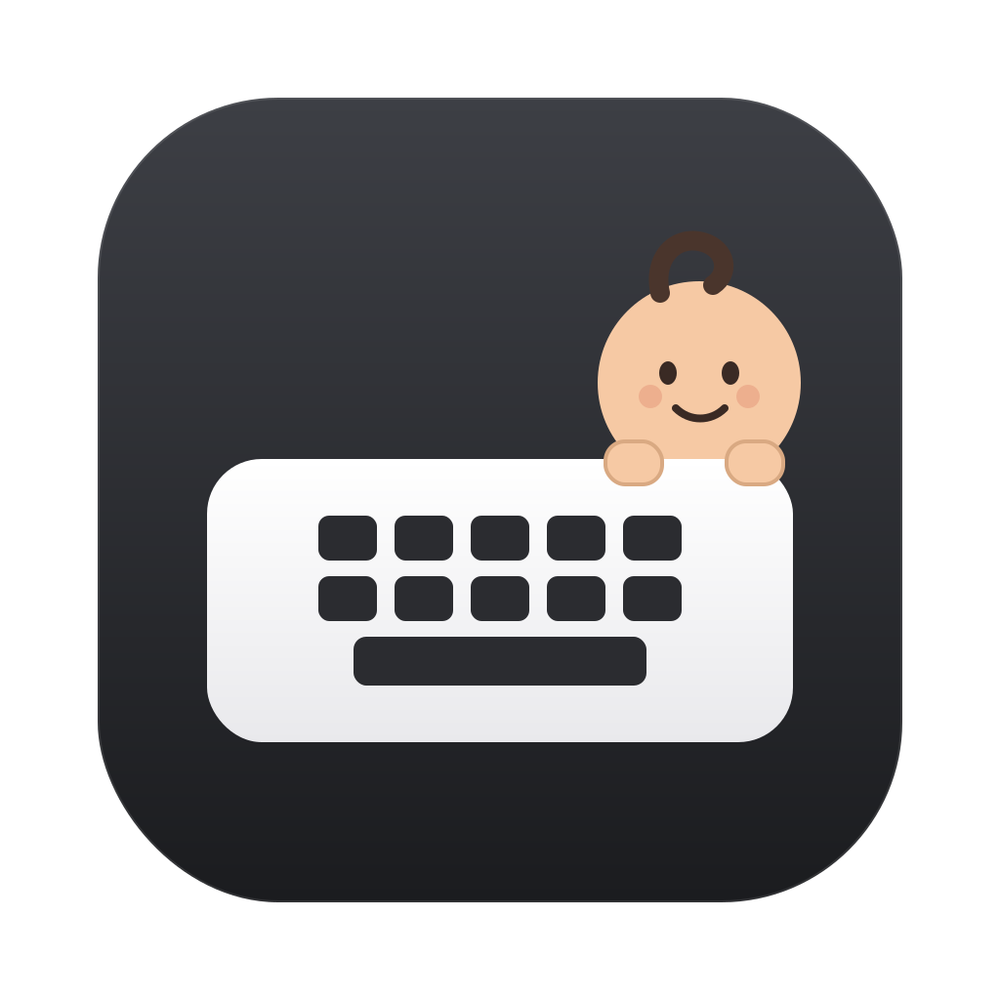

# Baby Lock

**A child lock for your Mac keyboard.**

<p align="center">
  
</p>

<p align="center">
  <a href="https://github.com/Mirr0ch1/BabyLock-macOS/actions/workflows/build.yml"></a>
</p>

Baby Lock is a tiny menu bar utility for families. It blocks the keyboard (and optionally the trackpad and mouse) so a curious toddler can bang on your MacBook without typing anything, closing your windows, or sending half-finished messages.

It is a fork of [CleanLock](https://github.com/fromtimo/CleanLock), reframed and rebuilt for parents.

---

## Why I built this

I work from home. My daughter likes to climb onto my lap, point at the screen, and then — with great enthusiasm — slap the keyboard.

Most of the time nothing catastrophic happens. But every so often a stray palm hits `⌘W`, a tiny finger finds the power key, or a full sentence of gibberish lands in a chat window. Turning the Mac off is overkill. Locking the whole screen means I cannot show her anything. Simply moving the laptop away interrupts the moment.

Baby Lock is the middle ground: **the Mac keeps working, the screen stays visible, and the keyboard stops listening.**

I turn it on from the menu bar before she reaches the keyboard. When she is done, I hold the left and right `⌘` keys for three seconds and everything is back.

## 中文简介

Baby Lock 是一个 macOS 菜单栏童锁。开启后，键盘（可选触控板和鼠标）不再响应，孩子拍打键盘也不会产生任何输入。屏幕默认保持原样，只在底部显示一条解锁提示；也可以在设置里选择让所有屏幕或仅主屏幕变黑。

解锁方式：同时按住左右 `Command` 键 3 秒。

支持 English、简体中文、繁體中文、Français、Русский。默认跟随系统语言，系统语言不在支持列表时自动使用英语。

本项目基于 [CleanLock](https://github.com/fromtimo/CleanLock) 改写，针对有娃家庭的使用场景做了优化，感谢原作者。

## How it works

1. Click the Baby Lock icon in the menu bar.
2. Choose **Turn on Baby Lock**.
3. A small floating hint appears at the bottom of the screen. The keyboard no longer responds.
4. To unlock, hold the **left and right Command keys for 3 seconds**.

By default the desktop stays exactly as it is. Nothing is covered, nothing turns black, and none of your apps lose focus. If you prefer a clean dark surface — for example while wiping the keyboard — enable **Black out displays** in Settings.

## Features

- Blocks every key, including shortcuts and media keys.
- Optionally blocks trackpad/mouse clicks, scrolling, gestures, and hides the pointer.
- Unlocks with `Left ⌘` + `Right ⌘` held for 3 seconds.
- Shows unlock progress and the safety countdown in a compact floating HUD.
- Optional full-screen blackout, off by default. Can cover all displays or only the main display.
- Automatic safety timeout: 5, 10, or 20 minutes.
- Runs as a native macOS menu bar app (`LSUIElement`), no Dock icon.
- Follows the system language by default; falls back to English.
- Ships with **English, 简体中文, 繁體中文, Français, and Русский**.
- No network access, no analytics, no key logging. Everything stays on your Mac.

## What is different from CleanLock

Baby Lock started as a fork of [CleanLock](https://github.com/fromtimo/CleanLock) and keeps its excellent input-blocking core. The changes are aimed at everyday family use:

| | CleanLock | Baby Lock |
|---|---|---|
| Purpose | Cleaning the MacBook | Keeping a child's input out |
| Default screen | Full-screen black overlay | Desktop stays visible, small HUD hint |
| Blackout | Always on | Optional, off by default |
| Display scope | All / main display | Same, only when blackout is enabled |
| Pointer blocking | Always on | Optional, on by default |
| Languages | English, Russian | English, 简体中文, 繁體中文, Français, Русский |
| Icon | Keyboard + lock | Keyboard + baby |
| Builds | Local Xcode | GitHub Actions (universal macOS build) |

## Installation

1. Open the [latest release](https://github.com/Mirr0ch1/BabyLock-macOS/releases).
2. Download `BabyLock-macOS.zip` and unzip it.
3. Drag **Baby Lock.app** into `/Applications`.
4. The build is ad-hoc signed but **not notarized by Apple**, so macOS may warn on first launch. If it says the app is damaged, run:

   ```bash
   xattr -dr com.apple.quarantine "/Applications/Baby Lock.app"
   ```

5. Launch Baby Lock and complete the onboarding.

## Permissions

Baby Lock needs two macOS permissions:

- **Accessibility** — to block keyboard and pointer events while the lock is on.
- **Input Monitoring** — to recognize the left/right Command unlock gesture.

Both are used only locally. Keystrokes are never recorded, stored, or transmitted.

> Because the release is ad-hoc signed, macOS may ask for permissions again after replacing the app with a new build. This is expected for unsigned builds.

## Settings

- **Launch at login**
- **Language** — follow the system, or pin one of the five languages
- **Auto-unlock** — safety timer (5/10/20 minutes)
- **Block trackpad and mouse** — on by default
- **Black out displays** — off by default, with all-displays / main-display scope

## Build

### GitHub Actions

Every push to `main` and every tag builds a universal (`arm64` + `x86_64`) app on a macOS runner, signs it ad hoc, and uploads `BabyLock-macOS.zip`. Tags matching `v*` also publish a GitHub release.

### Local development

Requirements: macOS 13+, Xcode 15+.

```bash
open BabyLock.xcodeproj
# or
./Scripts/run-debug.sh
```

`Scripts/build-debug.sh` assembles `build/Debug/Baby Lock.app` with `swiftc` and copies the localization bundles. `Scripts/reset-dev-state.sh` clears preferences and TCC entries for a clean run.

Regenerate the app icon (requires `python3 -m pip install cairosvg`):

```bash
python3 Scripts/generate-icons.py
```

## Localization

All user-facing strings live in standard `.lproj/Localizable.strings` bundles:

```
BabyLock/Resources/en.lproj/Localizable.strings
BabyLock/Resources/zh-Hans.lproj/Localizable.strings
BabyLock/Resources/zh-Hant.lproj/Localizable.strings
BabyLock/Resources/fr.lproj/Localizable.strings
BabyLock/Resources/ru.lproj/Localizable.strings
```

Missing keys fall back to English. To add a language, add the `.lproj` folder, register it in `BabyLock.xcodeproj`, and add the language to `AppLanguage`.

## Credits

Baby Lock is based on **[CleanLock](https://github.com/fromtimo/CleanLock)** by [fromtimo](https://github.com/fromtimo). The input-blocking architecture, permission handling, and unlock gesture come from that project. Huge thanks to the original author.

Baby Lock keeps the original MIT license and copyright notice; see [LICENSE](LICENSE).

## License

MIT. See [LICENSE](LICENSE).
