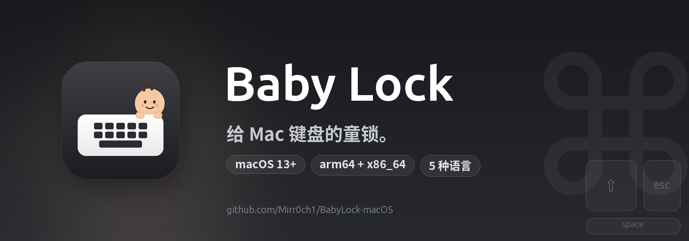

<p align="center">
  
</p>

<p align="center">
  <a href="https://github.com/Mirr0ch1/BabyLock-macOS/actions/workflows/build.yml"></a>
  <a href="https://github.com/Mirr0ch1/BabyLock-macOS/releases/latest"></a>
  <a href="https://github.com/Mirr0ch1/BabyLock-macOS/releases"></a>
  
</p>

<p align="center">
  
  
  
  
</p>

<p align="center">
  
  
  
</p>

<p align="center">
  <b>简体中文</b> · <a href="README.en.md">English</a> · <a href="README.zh-Hant.md">繁體中文</a> · <a href="README.fr.md">Français</a> · <a href="README.ru.md">Русский</a>
</p>

<h1 align="center">Baby Lock</h1>

<p align="center">
  <b>给 Mac 键盘的童锁。</b><br>
  孩子在键盘上拍来拍去，你的 Mac 什么都不会做。
</p>

---

## 为什么做这个

我在家办公。女儿喜欢爬到我腿上，指着屏幕，然后非常热情地拍键盘。

大多数时候没什么大事。但偶尔会有手掌压到 `⌘W`，小手指按到电源键，或者一段乱码直接发进聊天窗口。关机太重，锁屏又没法给她看东西，把电脑挪开则会打断当下的兴致。

Baby Lock 是中间方案：**Mac 继续工作，屏幕保持可见，键盘暂时不听话。**

她靠近键盘之前，我从菜单栏打开它；她玩够了，我同时按住左右 `⌘` 三秒，一切恢复。

## 工作原理

1. 点击菜单栏里的 Baby Lock 图标。
2. 选择 **开启 Baby Lock**。
3. 屏幕底部出现一条浮动提示，键盘不再响应。
4. 解锁时，同时按住 **左右 Command 键 3 秒**。

默认情况下桌面保持原样：不黑屏、不切应用、不抢焦点。想擦键盘时，可以在设置里打开 **屏幕变黑**。

## 功能

- 屏蔽所有按键，包括快捷键和媒体键。
- 可选屏蔽触控板和鼠标的点击、滚动、手势，并隐藏指针。
- 同时按住左右 `⌘` 三秒解锁，带进度环反馈。
- 可选全屏黑屏，默认关闭；支持所有屏幕或仅主屏幕。
- 自动解锁安全计时：5 / 10 / 20 分钟。
- 原生菜单栏应用（`LSUIElement`），不占 Dock。
- 默认跟随系统语言，非支持语言自动回落英语。
- 五种语言：English、简体中文、繁體中文、Français、Русский。
- 不联网、不收集分析、不记录按键。

## 和 CleanLock 的区别

Baby Lock 基于 [CleanLock](https://github.com/fromtimo/CleanLock) 改写，保留了它可靠的输入封锁内核，并针对有娃家庭做了调整：

| | CleanLock | Baby Lock |
|---|---|---|
| 用途 | 清洁 MacBook | 挡住孩子的误触 |
| 默认画面 | 全屏黑色遮罩 | 桌面保持可见，底部小浮窗 |
| 黑屏 | 始终开启 | 可选，默认关闭 |
| 屏幕范围 | 所有 / 仅主屏幕 | 相同，仅黑屏模式下生效 |
| 指针封锁 | 始终开启 | 可选，默认开启 |
| 语言 | 英语、俄语 | 英语、简体中文、繁體中文、法语、俄语 |
| 图标 | 键盘 + 锁 | 键盘 + 娃娃 |
| 构建 | 本地 Xcode | GitHub Actions（通用二进制） |

## 安装

1. 打开 [最新 Release](https://github.com/Mirr0ch1/BabyLock-macOS/releases)。
2. 下载 `BabyLock-macOS.zip` 并解压。
3. 把 **Baby Lock.app** 拖进 `/Applications`。
4. 当前构建是 ad-hoc 签名，**没有经过 Apple 公证**，首次打开可能被 macOS 拦截。如果提示“已损坏”，在终端执行：

   ```bash
   xattr -dr com.apple.quarantine "/Applications/Baby Lock.app"
   ```

5. 启动 Baby Lock，按引导完成设置。

## 权限

Baby Lock 需要两项 macOS 权限：

- **辅助功能**：开启期间屏蔽键盘和指针事件。
- **输入监控**：识别左右 Command 解锁手势。

两项权限都只在本地使用。不会记录按键，不会上传，也不会联网。

> 因为发布包是 ad-hoc 签名，替换新版本后 macOS 可能要求重新授权。

## 设置

- **登录时启动**
- **语言**：跟随系统，或固定为五种语言之一
- **自动解锁**：安全计时（5 / 10 / 20 分钟）
- **锁定触控板和鼠标**：默认开启
- **屏幕变黑**：默认关闭，可选择所有屏幕或仅主屏幕

## 构建

### GitHub Actions

推送到 `main` 或打 `v*` tag 时，会在 macOS runner 上构建 `arm64 + x86_64` 通用包，ad-hoc 签名后上传 `BabyLock-macOS.zip`。打 tag 还会自动创建 GitHub Release。

### 本地开发

要求：macOS 13+、Xcode 15+。

```bash
open BabyLock.xcodeproj
# 或
./Scripts/run-debug.sh
```

`Scripts/build-debug.sh` 用 `swiftc` 组装 `build/Debug/Baby Lock.app`。`Scripts/reset-dev-state.sh` 会清掉偏好设置和 TCC 授权，方便干净地重测。

重新生成图标和横幅：

```bash
python3 -m pip install cairosvg pillow
python3 Scripts/generate-icons.py
python3 Scripts/generate-banner.py
```

## 本地化

所有界面文案都在标准 `.lproj/Localizable.strings` 里：

```text
BabyLock/Resources/en.lproj/Localizable.strings
BabyLock/Resources/zh-Hans.lproj/Localizable.strings
BabyLock/Resources/zh-Hant.lproj/Localizable.strings
BabyLock/Resources/fr.lproj/Localizable.strings
BabyLock/Resources/ru.lproj/Localizable.strings
```

缺少翻译时会自动回退英语。要新增语言，添加 `.lproj` 目录、在 `BabyLock.xcodeproj` 里注册，并在 `AppLanguage` 中加入对应语言。

## 致谢

Baby Lock 基于 **[CleanLock](https://github.com/fromtimo/CleanLock)** 改写，原作者是 [fromtimo](https://github.com/fromtimo)。输入封锁架构、权限处理和 Command 解锁手势都来自这个项目，非常感谢原作者。

原始 MIT 协议和版权声明均已保留，详见 [LICENSE](LICENSE)。

## 许可证

MIT，详见 [LICENSE](LICENSE)。
