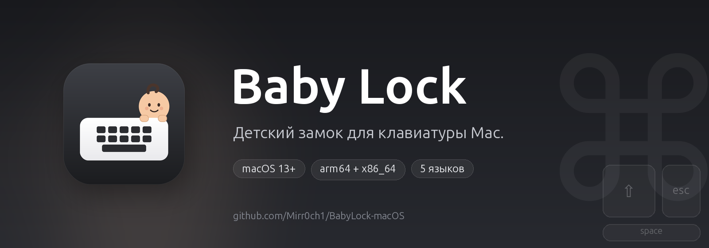

<p align="center">
  
</p>

<p align="center">
  <a href="https://github.com/Mirr0ch1/BabyLock-macOS/actions/workflows/build.yml"></a>
  <a href="https://github.com/Mirr0ch1/BabyLock-macOS/releases/latest"></a>
  <a href="https://github.com/Mirr0ch1/BabyLock-macOS/releases"></a>
  
</p>

<p align="center">
  
  
  
  
</p>

<p align="center">
  
  
  
</p>

<p align="center">
  <a href="README.md">简体中文</a> · <a href="README.en.md">English</a> · <a href="README.zh-Hant.md">繁體中文</a> · <a href="README.fr.md">Français</a> · <b>Русский</b>
</p>

<h1 align="center">Baby Lock</h1>

<p align="center">
  <b>Детский замок для клавиатуры Mac.</b><br>
  Ребёнок может стучать по клавиатуре — ничего не произойдёт.
</p>

---

## Зачем я это сделал

Я работаю из дома. Дочь любит залезать ко мне на колени, показывать на экран, а потом — с большим энтузиазмом — стучать по клавиатуре.

Обычно ничего страшного не происходит. Но иногда ладонь попадает на `⌘W`, маленький палец находит кнопку питания, или целая строка бессмыслицы уходит прямо в окно чата. Выключать Mac — слишком грубо. Блокировать весь экран — значит не показать ей ничего. Убирать ноутбук — прерывать момент.

Baby Lock — компромисс: **Mac продолжает работать, экран остаётся видимым, а клавиатура перестаёт слушать.**

Я включаю его из строки меню, прежде чем она доберётся до клавиатуры. Когда она закончила, я удерживаю левую и правую `⌘` три секунды, и всё возвращается.

## Как это работает

1. Нажмите на иконку Baby Lock в строке меню.
2. Выберите **Включить Baby Lock**.
3. Внизу экрана появляется небольшая подсказка. Клавиатура больше не отвечает.
4. Чтобы разблокировать, удерживайте **левую и правую Command 3 секунды**.

По умолчанию рабочий стол остаётся как есть: без чёрного экрана, переключения приложений и кражи фокуса. Если нужна тёмная поверхность — например, чтобы протереть клавиатуру — включите **Затемнять экраны** в настройках.

## Возможности

- Блокирует все клавиши, включая сочетания и мультимедийные клавиши; можно оставить одну или несколько клавиш рабочими (например, 🌐 Fn для голосового ввода или `⌃` + `C` + `V` для копирования и вставки).
- Проверяет обновления на GitHub при запуске и из строки меню, скачивает, проверяет, устанавливает и перезапускает приложение.
- По желанию блокирует клики, прокрутку и жесты трекпада/мыши и скрывает курсор.
- Разблокировка удержанием `⌘` слева + `⌘` справа 3 секунды, с кольцом прогресса.
- Опциональное затемнение всего экрана, по умолчанию выключено; все экраны или только главный.
- Страховочный таймер: 5, 10 или 20 минут.
- Нативное приложение в строке меню (`LSUIElement`), без иконки в Dock.
- Следует языку системы с откатом на английский.
- Пять языков: English, 简体中文, 繁體中文, Français, Русский.
- Без аналитики и записи нажатий; единственный сетевой запрос — проверка обновлений на GitHub.

## Отличия от CleanLock

Baby Lock — форк [CleanLock](https://github.com/fromtimo/CleanLock), который сохраняет надёжное ядро блокировки ввода. Изменения рассчитаны на повседневное использование в семье:

| | CleanLock | Baby Lock |
|---|---|---|
| Назначение | Чистка MacBook | Защита от ввода ребёнка |
| Экран по умолчанию | Чёрное полноэкранное затемнение | Рабочий стол виден, маленькая подсказка |
| Затемнение | Всегда включено | Опционально, по умолчанию выключено |
| Охват экранов | Все / главный | То же, только в режиме затемнения |
| Блокировка указателя | Всегда включена | Опционально, включена по умолчанию |
| Языки | Английский, русский | Английский, 简体中文, 繁體中文, французский, русский |
| Иконка | Клавиатура + замок | Клавиатура + малыш |
| Сборка | Локальный Xcode | GitHub Actions (универсальный бинарник) |

## Установка

1. Откройте [последний релиз](https://github.com/Mirr0ch1/BabyLock-macOS/releases).
2. Скачайте `BabyLock-macOS.zip` и распакуйте.
3. Перетащите **Baby Lock.app** в `/Applications`.
4. Сборка подписана ad hoc, но **не нотаризована Apple**, поэтому macOS может предупредить при первом запуске. Если приложение считается повреждённым, выполните:

   ```bash
   xattr -dr com.apple.quarantine "/Applications/Baby Lock.app"
   ```

5. Запустите Baby Lock и пройдите первичную настройку.

## Разрешения

Baby Lock нужны два разрешения macOS:

- **Универсальный доступ** — чтобы блокировать события клавиатуры и указателя, пока блокировка включена.
- **Мониторинг ввода** — чтобы распознавать жест разблокировки левой и правой Command.

Оба используются только локально. Нажатия не записываются и не передаются. Необязательные исключённые клавиши хранятся в настройках.

> Сборка подписана ad hoc, поэтому macOS может снова запросить разрешения после замены приложения новой версией.

## Настройки

- **Запускать при входе**
- **Язык** — следовать системе или выбрать один из пяти языков
- **Авторазблокировка** — страховочный таймер (5 / 10 / 20 минут)
- **Блокировать трекпад и мышь** — включено по умолчанию
- **Исключённые клавиши** — работают при блокировке; можно добавить несколько клавиш. Для сочетания добавьте каждую клавишу отдельно (например, `⌃`, `C`, `V`); если метод ввода перехватывает Fn, нажмите **Привязать Fn**
- **Затемнять экраны** — выключено по умолчанию, с охватом всех экранов / только главного
- **Проверить обновления** (строка меню) — проверяет GitHub и устанавливает новую версию

## Обновления

Baby Lock проверяет обновления на GitHub при запуске. Чтобы проверить вручную, выберите **Проверить обновления** в строке меню; если есть новая версия, пункт покажет её номер и установит после подтверждения.

Обновление скачивается из релиза, проверяется, копируется на место текущего приложения, после чего приложение автоматически перезапускается. Сборки подписаны ad-hoc, поэтому после обновления macOS может попросить заново разрешить «Универсальный доступ» и «Мониторинг ввода». Baby Lock сам откроет экран разрешений с кнопкой сброса.

## Сборка

### GitHub Actions

Каждый push в `main` и каждый тег `v*` собирает универсальное приложение `arm64 + x86_64` на macOS runner, подписывает его ad hoc и загружает `BabyLock-macOS.zip`. Теги также публикуют GitHub Release.

### Локальная разработка

Требования: macOS 13+, Xcode 15+.

```bash
open BabyLock.xcodeproj
# или
./Scripts/run-debug.sh
```

`Scripts/build-debug.sh` собирает `build/Debug/Baby Lock.app` через `swiftc`. `Scripts/reset-dev-state.sh` очищает настройки и записи TCC для чистой проверки.

Перегенерировать иконки и баннеры:

```bash
python3 -m pip install cairosvg pillow
python3 Scripts/generate-icons.py
python3 Scripts/generate-banner.py
```

## Локализация

Все строки интерфейса лежат в стандартных `.lproj/Localizable.strings`:

```text
BabyLock/Resources/en.lproj/Localizable.strings
BabyLock/Resources/zh-Hans.lproj/Localizable.strings
BabyLock/Resources/zh-Hant.lproj/Localizable.strings
BabyLock/Resources/fr.lproj/Localizable.strings
BabyLock/Resources/ru.lproj/Localizable.strings
```

Отсутствующие ключи откатываются на английский. Чтобы добавить язык, создайте каталог `.lproj`, зарегистрируйте его в `BabyLock.xcodeproj` и добавьте язык в `AppLanguage`.

## Благодарности

Baby Lock основан на **[CleanLock](https://github.com/fromtimo/CleanLock)** от [fromtimo](https://github.com/fromtimo). Архитектура блокировки ввода, обработка разрешений и жест разблокировки взяты из этого проекта. Большое спасибо автору оригинала.

Оригинальная лицензия MIT и уведомление об авторских правах сохранены; см. [LICENSE](LICENSE).

## Лицензия

MIT. См. [LICENSE](LICENSE).
