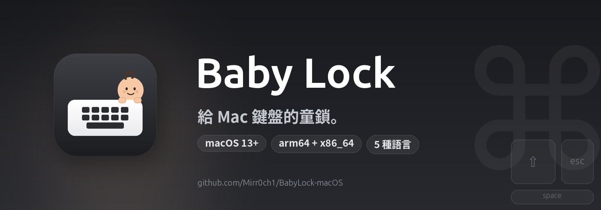

<p align="center">
  
</p>

<p align="center">
  <a href="https://github.com/Mirr0ch1/BabyLock-macOS/actions/workflows/build.yml"></a>
  <a href="https://github.com/Mirr0ch1/BabyLock-macOS/releases/latest"></a>
  <a href="https://github.com/Mirr0ch1/BabyLock-macOS/releases"></a>
  
</p>

<p align="center">
  
  
  
  
</p>

<p align="center">
  
  
  
</p>

<p align="center">
  <a href="README.md">简体中文</a> · <a href="README.en.md">English</a> · <b>繁體中文</b> · <a href="README.fr.md">Français</a> · <a href="README.ru.md">Русский</a>
</p>

<h1 align="center">Baby Lock</h1>

<p align="center">
  <b>給 Mac 鍵盤的童鎖。</b><br>
  孩子在鍵盤上拍來拍去，你的 Mac 什麼都不會做。
</p>

---

## 為什麼做這個

我在家工作。女兒喜歡爬到我腿上，指著螢幕，然後非常熱情地拍鍵盤。

大多數時候沒什麼大事。但偶爾會有手掌壓到 `⌘W`，小手指按到電源鍵，或者一段亂碼直接送進聊天視窗。關機太重，鎖定整個螢幕又沒辦法給她看東西，把電腦移開則會打斷當下的興致。

Baby Lock 是中間方案：**Mac 繼續運作，螢幕保持可見，鍵盤暫時不理人。**

她靠近鍵盤之前，我從選單列開啟它；她玩夠了，我同時按住左右 `⌘` 三秒，一切恢復。

## 運作方式

1. 點一下選單列裡的 Baby Lock 圖示。
2. 選擇 **開啟 Baby Lock**。
3. 螢幕底部出現一條浮動提示，鍵盤不再回應。
4. 解鎖時，同時按住 **左右 Command 鍵 3 秒**。

預設情況下桌面保持原樣：不黑屏、不切換應用程式、不搶焦點。想擦拭鍵盤時，可以在設定裡開啟 **螢幕變黑**。

## 功能

- 封鎖所有按鍵，包括快速鍵、媒體鍵和電源鍵短按；可保留一個或多個豁免按鍵（例如用 🌐 Fn 觸發語音輸入，或新增 `⌃`、`C`、`V` 來保留複製貼上）。
- 啟動時和選單列中可檢查 GitHub Release 更新，自動下載、驗證、安裝並重新啟動。
- 鎖定失效或更新後，可在權限頁一鍵重置權限並重新授權。
- 可選擇封鎖觸控式軌跡板和滑鼠的點按、捲動、手勢，並隱藏指標。
- 同時按住左右 `⌘` 三秒解鎖，附進度環回饋。
- 可選擇全螢幕黑屏，預設關閉；支援所有螢幕或僅主螢幕。
- 自動解鎖安全計時：5 / 10 / 20 分鐘。
- 原生選單列應用程式（`LSUIElement`），不佔 Dock。
- 預設跟隨系統語言，非支援語言自動回退英語。
- 五種語言：English、简体中文、繁體中文、Français、Русский。
- 不收集分析、不記錄按鍵；唯一的網路請求是檢查 GitHub 更新。

## 與 CleanLock 的差異

Baby Lock 基於 [CleanLock](https://github.com/fromtimo/CleanLock) 改寫，保留它可靠的輸入封鎖核心，並針對有小孩的家庭做了調整：

| | CleanLock | Baby Lock |
|---|---|---|
| 用途 | 清潔 MacBook | 擋住孩子的誤觸 |
| 預設畫面 | 全螢幕黑色遮罩 | 桌面保持可見，底部小浮窗 |
| 黑屏 | 始終開啟 | 可選，預設關閉 |
| 螢幕範圍 | 所有 / 僅主螢幕 | 相同，僅黑屏模式下生效 |
| 指標封鎖 | 始終開啟 | 可選，預設開啟 |
| 語言 | 英語、俄語 | 英語、简体中文、繁體中文、法語、俄語 |
| 圖示 | 鍵盤 + 鎖 | 鍵盤 + 娃娃 |
| 建置 | 本機 Xcode | GitHub Actions（通用二進位） |

## 安裝

1. 開啟 [最新 Release](https://github.com/Mirr0ch1/BabyLock-macOS/releases)。
2. 下載 `BabyLock-macOS.zip` 並解壓縮。
3. 把 **Baby Lock.app** 拖進 `/Applications`。
4. 目前建置是 ad-hoc 簽名，**沒有經過 Apple 公證**，首次開啟可能被 macOS 攔截。如果提示「已損毀」，請在終端機執行：

   ```bash
   xattr -dr com.apple.quarantine "/Applications/Baby Lock.app"
   ```

   只從本專案的 [Releases](https://github.com/Mirr0ch1/BabyLock-macOS/releases) 下載，並用 Release 裡的 `.sha256` 和 `.sig` 核對檔案；不要使用第三方轉載的安裝包。

5. 啟動 Baby Lock，依照引導完成設定。

## 權限

Baby Lock 需要兩項 macOS 權限：

- **輔助使用**：開啟期間封鎖鍵盤和指標事件。
- **輸入監控**：辨識左右 Command 解鎖手勢。

兩項權限都只在本地使用。不會記錄或上傳按鍵；唯一的網路請求是檢查 GitHub 更新。可選的豁免按鍵僅保存在本機偏好設定中。

> 因為發佈包是 ad-hoc 簽名，替換新版本後 macOS 可能要求重新授權。

如果系統設定裡已經勾選，但 Baby Lock 仍提示未授權，代表系統裡留下的是舊版本的授權記錄。開啟權限頁，點 **重置權限並重試**：Baby Lock 會清除自己的輔助使用與輸入監控記錄、重新啟動，然後再次請求授權。

## 設定

- **登入時啟動**
- **語言**：跟隨系統，或固定為五種語言之一
- **自動解鎖**：安全計時（5 / 10 / 20 分鐘）
- **鎖定觸控式軌跡板和滑鼠**：預設開啟
- **豁免按鍵**：鎖定期間仍可用；可新增多個按鍵，組合鍵需要把每個按鍵分別加進來（例如 `⌃`、`C`、`V`）；如果 Fn 被輸入法攔截，可直接點 **綁定 Fn 鍵**
- **螢幕變黑**：預設關閉，可選擇所有螢幕或僅主螢幕
- **檢查更新**（選單列）：檢查 GitHub Release 並安裝新版本

## 更新

Baby Lock 啟動時會檢查一次 GitHub Release。啟動檢查在背景靜默進行：沒有更新時選單列保持 **檢查更新**，只有發現新版本才會直接顯示版本號。也可以在選單列點 **檢查更新**：

- 選單會保持開啟，先顯示 **正在檢查更新…**；
- 沒有更新：顯示 **未偵測到更新**，3 秒後自動恢復成 **檢查更新**；
- 有更新：顯示 **有更新 vX.Y.Z — 點擊安裝**，確認後下載、驗證 Ed25519 簽名、bundle ID 和版本號，替換目前的 App，重置權限並自動重新啟動。

更新包帶有 Ed25519 簽名；App 內建公鑰，簽名缺失或不相符時不會安裝，會保留目前版本。

更新要求 App 位於 `/Applications` 或 `~/Applications`。由於發佈包使用 ad-hoc 臨時簽名，macOS 可能會在更新後要求重新授權；Baby Lock 會自動開啟權限介面，並提供「重置權限並重試」按鈕。

## 限制

- 鎖定期間會自動封鎖電源鍵短按；長按電源鍵 5–10 秒仍可強制關機，這是硬體逃生口。
- 闔上螢幕或系統睡眠後，喚醒時會自動重新鎖定。
- 重新啟動、強制關機或強退後不會恢復鎖定；鎖定狀態只保存在記憶體中。
- 解鎖手勢會顯示在 HUD 上。會閱讀的孩子可以學會，因此它不是防大孩子的強安全鎖。
- 如果外接鍵盤沒有右 Command，解鎖手勢不可用；只能等待自動解鎖，或長按電源鍵強制關機。
- 同一使用者下的其他程式、Voice Control、螢幕共享、MDM 遠端管理等不受保護。
- 發佈包是 ad-hoc 簽名；首次安裝或更新後，macOS 可能要求重新授權。

## 建置

### GitHub Actions

推送到 `main` 或打 `v*` tag 時，會在 macOS runner 上建置 `arm64 + x86_64` 通用包，ad-hoc 簽名後上傳 `BabyLock-macOS.zip`；tag 建置還會產生 Ed25519 簽名和 SHA256，並自動建立 GitHub Release。

### 本機開發

需求：macOS 13+、Xcode 15+。

```bash
open BabyLock.xcodeproj
# 或
./Scripts/run-debug.sh
```

`Scripts/build-debug.sh` 會用 `swiftc` 組裝 `build/Debug/Baby Lock.app`。`Scripts/reset-dev-state.sh` 會清掉偏好設定和 TCC 授權，方便乾淨地重測。

重新產生圖示和橫幅：

```bash
python3 -m pip install cairosvg pillow
python3 Scripts/generate-icons.py
python3 Scripts/generate-banner.py
```

## 在地化

所有介面文字都在標準 `.lproj/Localizable.strings` 裡：

```text
BabyLock/Resources/en.lproj/Localizable.strings
BabyLock/Resources/zh-Hans.lproj/Localizable.strings
BabyLock/Resources/zh-Hant.lproj/Localizable.strings
BabyLock/Resources/fr.lproj/Localizable.strings
BabyLock/Resources/ru.lproj/Localizable.strings
```

缺少翻譯時會自動回退英語。要新增語言，加入 `.lproj` 目錄、在 `BabyLock.xcodeproj` 裡註冊，並在 `AppLanguage` 中加入對應語言。

## 致謝

Baby Lock 基於 **[CleanLock](https://github.com/fromtimo/CleanLock)** 改寫，原作者是 [fromtimo](https://github.com/fromtimo)。輸入封鎖架構、權限處理和 Command 解鎖手勢都來自這個專案，非常感謝原作者。

原始 MIT 授權和版權聲明均已保留，詳見 [LICENSE](LICENSE)。

## 授權

MIT，詳見 [LICENSE](LICENSE)。
